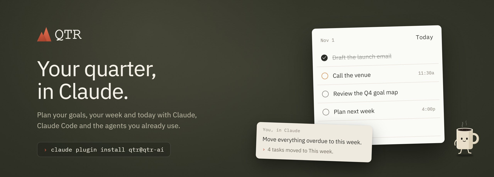

<div align="center">



**Plan your quarter, your week and today in [QTR](https://qtr.ai), from Claude.**

[Install](#install)&nbsp;&nbsp;&nbsp;&nbsp;[What you can do](#nearly-everything-you-do-in-qtr-now-through-your-agents)&nbsp;&nbsp;&nbsp;&nbsp;[Your data](#your-data)&nbsp;&nbsp;&nbsp;&nbsp;[Changelog](CHANGELOG.md)

</div>

<br>

QTR is a planner built around Working Backwards: goals for the quarter, a plan for each week, then the day's tasks. This plugin connects Claude to your QTR account and teaches it how QTR works. Claude can then read and change your tasks, goals, notes, focus sessions and calendars, and work with Ansel, QTR's own assistant.

Any QTR account works, Free or Pro. The Free plan keeps its limits.

## Install

**Claude Code**

```sh
claude plugin marketplace add qtr-ai/qtr-plugin
claude plugin install qtr@qtr-ai
```

Then run `/mcp` and sign in to QTR.

**Codex, Cursor, GitHub Copilot and other agents**

```sh
npx skills add qtr-ai/qtr-plugin
```

Then add `https://api.qtr.ai/mcp/sse` as an MCP server and sign in.

## Nearly everything you do in QTR, now through your agents

Tasks, goals, notes, focus, calendars, sharing and Ansel, asked for in your own words. In a team workspace too: name it ("my tasks in Design Team today") and Claude works there.


In Claude, these answers come with a view you can work in, right in the chat, drawn like the cards on your QTR desk:

- **Your tasks**: tick them off, or switch to another day of the week.
- **Time blocks**: your day with its meetings and the proposed blocks; place them in one click.
- **A goal's map**: the map as you drew it in QTR, or a list by checkpoint, with how far along it is.
- **Ansel's waiting changes**: apply, dismiss, undo or redo each one.
- **Your morning brief or evening wrap**: tick off the top three and say yes to Ansel's suggested move.
- **The quarter**: every goal, worst first; open one to see its map.
- **The focus clock**: watch it count down, then pause, resume or stop.

## What's inside

- **The QTR connector**: QTR's remote MCP server at `https://api.qtr.ai/mcp/sse`, signed in with OAuth. For a connection that can only read, use `https://api.qtr.ai/mcp/readonly`.
- **The `qtr` skill**: how QTR works (periods, goal maps, the desk, Ansel's proposals), the rules Claude follows before it changes anything, and every tool by area.
- **Commands for Claude Code**: `/qtr:today`, `/qtr:add`, `/qtr:plan-week`, `/qtr:review`, `/qtr:goal` and `/qtr:approvals`.
- **Tests**: cases in `evals/` that run against stand-ins for QTR, with `claude plugin eval .`

Nothing runs on your machine: no hooks and no local servers.

## Your data

- Claude reaches QTR only through the connector, over HTTPS. The sign-in lets Claude act as you in QTR and nowhere else.
- Your data stays in QTR, as its [privacy policy](https://qtr.ai/privacy) describes.
- Tool calls run as soon as Claude makes them. Claude asks before anything that deletes, changes many things at once or reaches other people, and the tools that change or remove data are marked so Claude asks before each one.
- On the Free plan, the app's limits apply here too: 50 tasks a month, 10 goals in total, 3 projects and 50 notes a month, and 5,000 tokens of QTR's AI a month. Pro has none. The connector has no rate limit of its own.
- To disconnect, remove the connector.

## Updates

When the skill changes, Claude tells you once, with what changed. claude.ai, Claude Desktop and Cowork update by themselves. In Claude Code, run `claude plugin update qtr@qtr-ai`, or turn on auto-update for the `qtr-ai` marketplace in `/plugin`. Elsewhere, run `npx skills update`.

<br>

---

<div align="center">
<sub><a href="https://qtr.ai">qtr.ai</a>&nbsp;&nbsp;&nbsp;&nbsp;<a href="mailto:support@qtr.ai">support@qtr.ai</a>&nbsp;&nbsp;&nbsp;&nbsp;<a href="https://help.qtr.ai">Help</a>&nbsp;&nbsp;&nbsp;&nbsp;<a href="https://qtr.ai/privacy">Privacy</a>&nbsp;&nbsp;&nbsp;&nbsp;<a href="https://qtr.ai/terms">Terms</a>&nbsp;&nbsp;&nbsp;&nbsp;MIT licence</sub>
</div>
